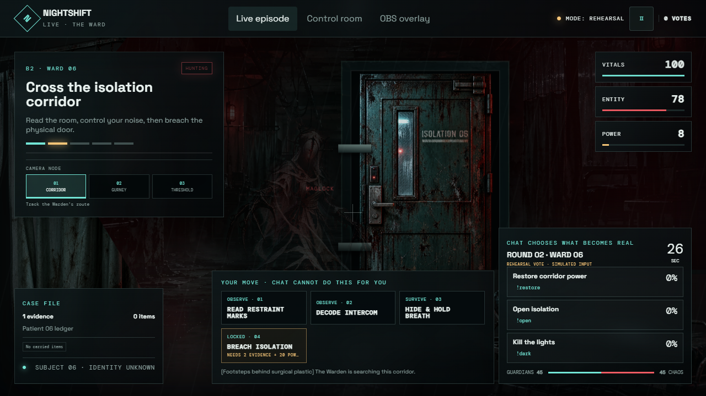
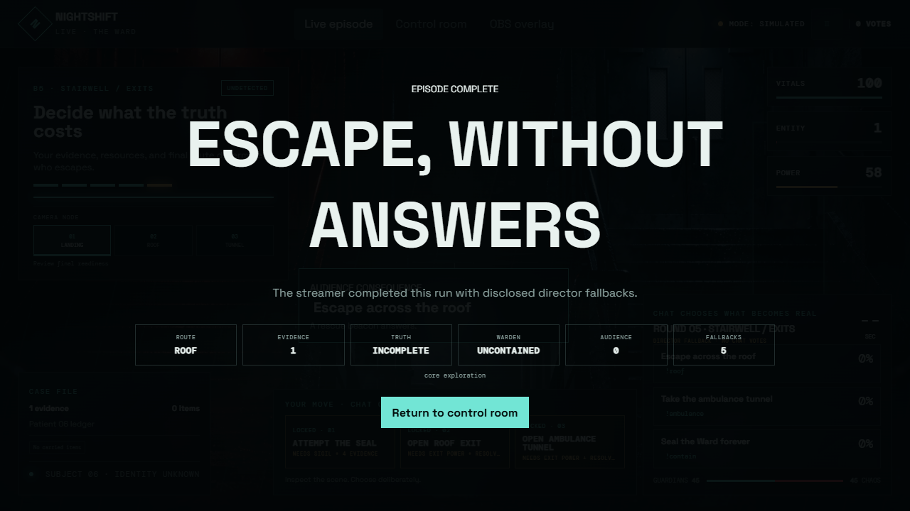
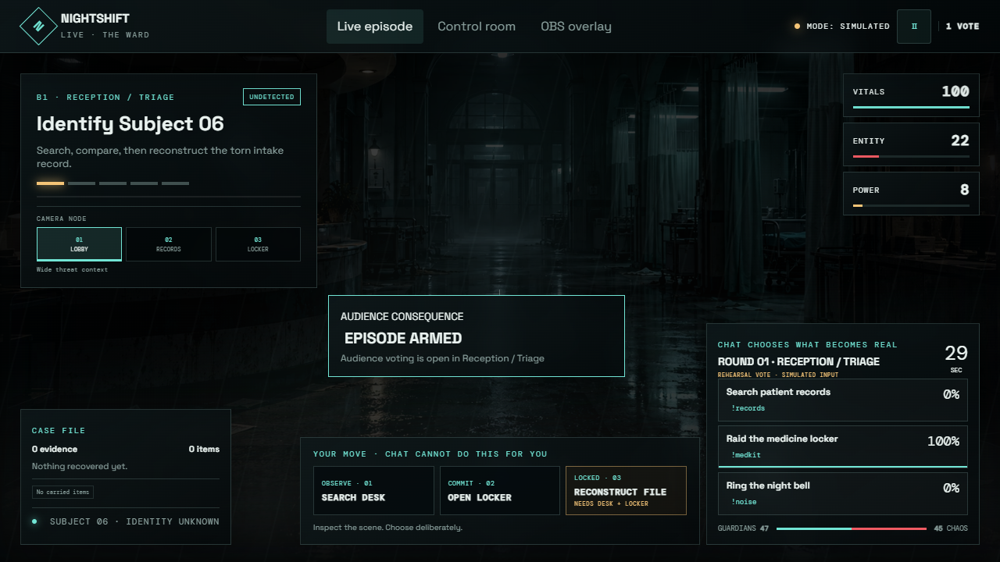
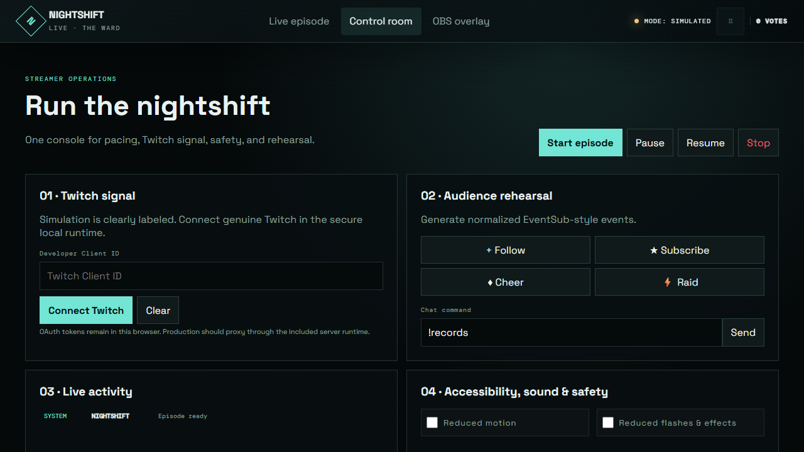

# NightShift Live: The Ward

NightShift Live turns a Twitch horror stream into a live game show. Viewers vote in chat, split into Guardians and Chaos Crew, and change a cinematic hospital survival sequence in real time.

## What is working

- A complete 3-screen web experience: playable broadcast view, streamer control room, and transparent OBS overlay preview.
- Deterministic audience voting with one active vote per viewer and command aliases.
- Twitch OAuth and EventSub WebSocket support for `channel.chat.message`, follows, subscriptions, cheers, and raids.
- A persistent five-act episode with evidence, usable/craftable inventory, checkpoints, authored prerequisites, door and power state, a breaker puzzle, director-safe fallbacks, and materially different endings with recaps.
- Three playable camera nodes in every act, with composition changes and persistent visited-node state.
- A UI-only 2.5D scene compositor with independent depth, fog, lighting, reflection, occlusion, rain, physical-door, foreground-prop, Warden, and HUD layers; no 3D meshes or engine runtime.
- Original phase-specific Warden, gurney, curtain, and isolation-door art with archived lossless sources and optimized public derivatives.
- Gesture-gated procedural room ambience and cues with mute/volume controls, reduced-effects variants, and visual captions.
- Demo autopilot and manual event triggers for a reliable no-credentials judging path.
- Cross-tab state transport with `BroadcastChannel` for separate game and overlay browser sources.
- Responsive safety/accessibility controls, modal focus handling, semantic state, pause shortcuts, reduced motion/flashes, and stable keyboard focus.
- Automated engine, Twitch lifecycle, accessibility, audio, visual, and full-browser campaign gates.

## Release captures

| Warden threat beat | Persistent ending recap |
| --- | --- |
|  |  |
| Full gameplay hierarchy | Streamer control room |
|  |  |

## Run in 30 seconds

Requires Node.js 20+.

```bash
npm start
```

Open `http://localhost:4173`, choose **Control room**, then **Start episode**. No Twitch account is required for the clearly labeled simulation path.

The preview server uses only Node.js built-ins, so startup does not download a package. Use `npm start -- --port 5000` when port 4173 is unavailable.

Run verification:

```bash
npm run check
npm run qa:visual
npm run qa:gameplay
npm run qa:integrity
npm run qa:relay
npm run release:audit
```

Current local release-candidate evidence: 64/64 automated tests, 28/28 visual states (including all 15 camera compositions), 7/7 browser campaign gates, 5/5 browser integrity gates, 16/16 two-process relay gates, zero captured browser-console errors, and an 11.6 MiB `dist/` payload. These checks do not replace the still-pending real Twitch, native OBS, public-HTTPS, and human-playtest gates.

Before sharing the entry, follow the logged-out hosting, OAuth callback, OBS alpha, and rollback steps in [`docs/PUBLIC_DEPLOYMENT.md`](docs/PUBLIC_DEPLOYMENT.md).

## Connect a real Twitch channel

1. Create an application in the [Twitch Developer Console](https://dev.twitch.tv/console/apps).
2. Add the exact URL where this app is running as an OAuth redirect URL. For local use: `http://localhost:4173/`.
3. Open **Control room**, paste the Client ID, and choose **Connect Twitch**.
4. Approve the requested read-only scopes. The app subscribes through Twitch EventSub over WebSocket.
5. Start the live sequence. Viewers vote with the commands shown on screen, such as `!restore` and `!dark`.

The OAuth token is stored only in that browser's local storage. It is never committed to source. Use **Clear** to remove it. Real Twitch end-to-end behavior is implemented but remains **unverified** until tested with a broadcaster credential and a second viewer account.

## OBS setup

For a real cross-process OBS run, start the included local server. Keep the authoritative control/game tab in Chrome, then use passive Browser Sources in OBS:

- Chrome controller: `http://localhost:4173/?relay=local`
- Full gameplay mirror in OBS: `http://localhost:4173/?role=mirror&relay=local`
- Transparent compact overlay in OBS: `http://localhost:4173/?view=overlay&role=mirror&relay=local`

Use 1920×1080 for the full view and the resolution of your OBS canvas for the compact overlay. The explicit `relay=local` path uses the loopback-only server's same-origin SSE relay, so OBS and Chrome receive the same sanitized state even though they are different browser processes. `role=mirror` makes the OBS copy non-interactive and prevents it from becoming a competing show controller. Without the relay flag, same-profile tabs use `BroadcastChannel` only.

## Repository map

```text
dist/
  index.html        Product UI and all three screens
  styles.css        Cinematic visual system and responsive layout
  app.mjs           UI, show loop, campaign controls, audio hooks, demo mode
  audio.mjs         Gesture-gated procedural audio and visual captions
  engine.mjs        Persistent episode, voting, factions, puzzles, and endings
  public-state.mjs  Strict validation for privacy-safe OBS transport
  runtime-mode.mjs  Truthful Twitch/rehearsal input-mode policy
  twitch.mjs        OAuth, Helix, and EventSub WebSocket bridge
  assets/           Optimized public visual assets
art-source/         Lossless source art excluded from static deployment
tests/
  *.test.mjs        Engine, campaign, Twitch, relay, audio, and accessibility tests
docs/
  ARCHITECTURE.md   Technical design and event flow
  QUALITY_TRACKER.md Evidence-backed V3 gate status
  SUBMISSION.md     Devpost-ready copy and checklist
  DEMO_SCRIPT.md    Under-three-minute video plan
  STATUS.md         Truthful implemented/simulated/unverified matrix
  ASSET_PROVENANCE.md Original V3 art manifest and integration notes
audit/
  AS_IS_AUDIT.md    V1 audit and V2 disposition
```

## Built with Codex

Codex was the primary build partner for product scoping, the visual system, original asset generation, the voting engine, Twitch integration, UI implementation, tests, and the submission package. Primary build session ID: `01a1976e-d289-7a22-9e87-7aefa57d3379`.

## Production hardening after the hackathon

The static prototype intentionally uses Twitch's implicit OAuth flow for the fastest reliable demo. A production multi-streamer service should move OAuth to an authorization-code flow with a small backend, use encrypted server-side refresh-token storage, add signed session identities, centralize cross-device show state, and apply per-channel moderation/rate controls.

## License

Project code and original assets are supplied for the hackathon project. Asset generation and derivative policy are recorded in `docs/ASSET_PROVENANCE.md`. Twitch is a trademark of Twitch Interactive, Inc.; this project is not endorsed by Twitch.
